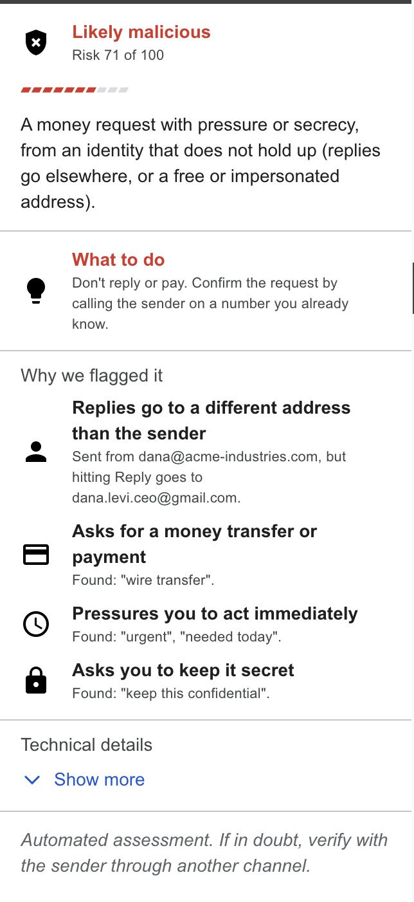
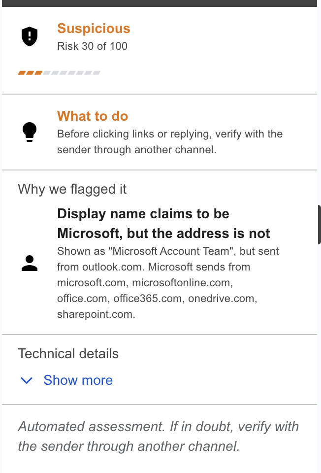
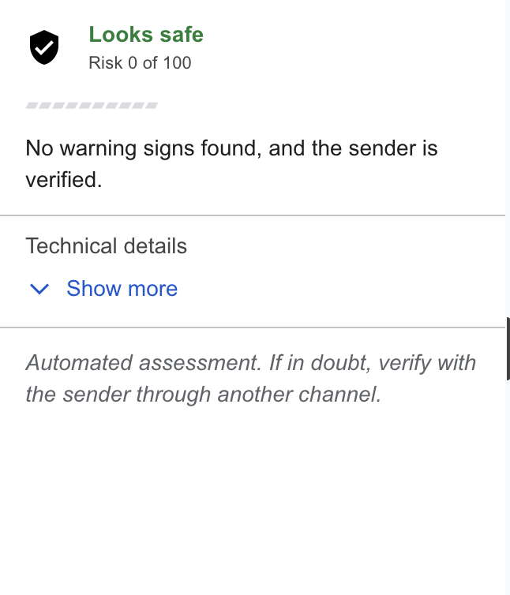
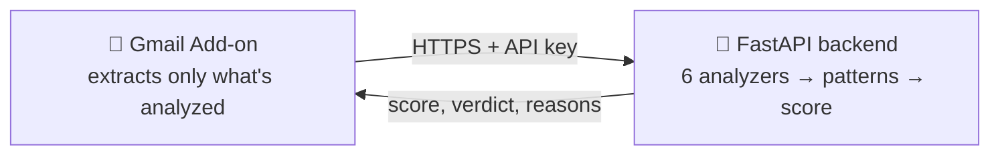

# 🛡️ Malicious Email Scorer

A Gmail Add-on that looks at the email you have open and tells you, in plain words, **how risky it is, why, and what to do about it.**

<table>
  <tr>
    <td align="center"><br><sub>CEO fraud: no links, passes authentication</sub></td>
    <td align="center"><br><sub>"Microsoft" on a free Outlook account</sub></td>
    <td align="center"><br><sub>A genuine, verified sender</sub></td>
  </tr>
</table>

## How it works



The **add-on is a thin client**: it reads the open email, sends only the fields that get analyzed, and draws the result. The **backend does the thinking**: six independent analyzers look for warning signs, then a second pass spots known attack *combinations*.

| Analyzer | Looks for |
|---|---|
| 🔐 **Authentication** | SPF, DKIM and DMARC, trusting only the header Gmail itself adds (attackers can forge their own) |
| 👤 **Sender** | "PayPal" in the name but not the address · look-alike domains (`paypa1.com`, `rnicrosoft.com`) · brand names inside other domains · Reply-To going elsewhere · Hebrew brand names too |
| 📅 **Domain age** | Domains registered days ago, which is typical of phishing campaigns (via RDAP) |
| 🔗 **Links** | Text showing one site while the link goes to another · raw IPs · look-alikes · URL shorteners. Links are **read, never opened**. |
| ✍️ **Content** | What the email *asks* you to do: pay, log in, hurry, keep it secret (English and Hebrew) |
| 📎 **Attachments** | Files that run code (`.exe`, `.js`, `.iso`) · macro documents · HTML files · disguised names like `invoice.pdf.exe` or a hidden right-to-left character. Judged by **name and type only**, never contents. |

### 🎯 Attack patterns

One signal often has an innocent explanation, because startups have new domains too. Some **combinations** don't:

| Pattern | When |
|---|---|
| **CEO / payment fraud** | money request + pressure or secrecy + an identity that doesn't hold up |
| **Credential phishing** | "verify your account" + a disguised link |
| **Malware delivery** | a risky or disguised attachment + a sender that doesn't hold up |
| **Brand impersonation** | pretends to be a brand + a brand-new domain |
| **Attacker-owned look-alike** | look-alike domain + passing authentication (they own the fake domain) |
| ✅ **Verified sender** | brand name + the brand's real domain + DMARC pass, which lowers the score |

The pattern becomes the card's headline, followed by **what to do** (e.g. *"Don't reply or pay. Confirm by calling the sender on a number you already know."*).

### 🧮 The score

Every finding has fixed points by severity: **low 8 · medium 15 · high 30 · critical 60**. The score is the sum (0–100), plus **+25** for the strongest attack pattern.
**0–24** 🟢 Looks safe · **25–59** 🟠 Suspicious · **60+** 🔴 Likely malicious.

Simple on purpose: **every point traces back to a reason you can read.** One deception counts once, so a name *and* domain faking PayPal is one finding, and ten bad links are one finding with examples.

## 🔒 Security and privacy

- **Least privilege.** The add-on can read *only the open message*, read-only, and can call *only* the backend (pinned URL).
- **Data minimization.** Only analyzed fields leave Gmail. Attachments go as name and type only, never contents. Nothing is stored, email content is never logged, and the API rejects anything extra.
- **Everything external is untrusted.** Size limits on every field, HTML parsed but never rendered, links never visited, all card text escaped, and even the backend's response is validated before display.
- **Secrets.** The API key is generated by Render, never committed, kept in Apps Script's Script Properties, and checked in constant time. The server refuses to start without one.
- **Resilient.** If one analyzer crashes on a crafted email, the others still score it.

## 🔮 What I'd add with more time

- 📅 **Domain age for links too**, not only for the sender (needs parallel lookups to stay within Gmail's 30-second limit).
- 📊 **Weights based on data.** Calibrate the points on a real labeled set of phishing and legitimate emails, instead of setting them by hand.
- 🤝 **"You've written to this sender before."** Gmail auto-saves people you've written to in *Other contacts*. Checking that list needs a much narrower permission than searching the mailbox (which requires *"read all your email"*), and it's a strong trust signal: an attacker can email you, but can't make you write to them first.
- 🎣 **QR-code phishing**, where the link hides inside an image.
- 🔑 **Stronger infrastructure.** Google-signed identity tokens instead of a shared API key, rate limiting, and a paid hosting plan that never sleeps. The free tier sleeps after 15 idle minutes, so for now a [GitHub Action](.github/workflows/keep-alive.yml) pings it every 10.
- 👍 **Feedback buttons** ("this is a false positive") to measure and keep improving accuracy.

## 🚀 Running it

**Backend (local):**
```bash
cd backend
python3 -m venv .venv && .venv/bin/pip install -r requirements-dev.txt
export API_KEY=$(python3 -c "import secrets; print(secrets.token_urlsafe(32))")
.venv/bin/uvicorn app.main:create_app --factory --port 8000
```

**Backend (deployed):** in Render, **New → Blueprint** → this repo. [`render.yaml`](render.yaml) does the rest, including a generated `API_KEY`.

**Add-on** (needs Node.js 20+):
1. `npm install && npx clasp login`, and turn on the Apps Script API at [script.google.com/home/usersettings](https://script.google.com/home/usersettings).
2. Create your own Apps Script project and put its `scriptId` in `.clasp.json` (keep `"rootDir": "addon"`).
3. Set your backend URL in [`addon/Api.gs`](addon/Api.gs) and in `urlFetchWhitelist` in [`addon/appsscript.json`](addon/appsscript.json), then `npm run addon:push`.
4. In the Apps Script editor, add a Script Property `API_KEY` (the value from Render).
5. **Deploy → Test deployments → Gmail → Install**, open an email, and click the 🛡️ in Gmail's side panel.

**Demo emails:** [`tools/demo-emails`](tools/demo-emails) drops seven safe `[Demo]` samples into *your own* inbox, one per behavior (fake PayPal, CEO fraud, Hebrew bank phishing, a disguised attachment, a verified sender…). Nothing is sent anywhere.

## ✅ Tests

```bash
cd backend && .venv/bin/python -m pytest && .venv/bin/ruff check .
```

222 tests, under a second, offline. They cover every analyzer, false-positive suites (real domains, everyday emails), and security cases like forged headers, malformed HTML and bad API keys.

## 📁 Structure

```
addon/              Gmail Add-on (Apps Script): extract → call backend → render card
backend/app/        FastAPI service: analyzers/, patterns.py, scoring.py, …
backend/tests/      pytest suite
tools/demo-emails/  Safe sample emails for demos
render.yaml         Render blueprint
```
